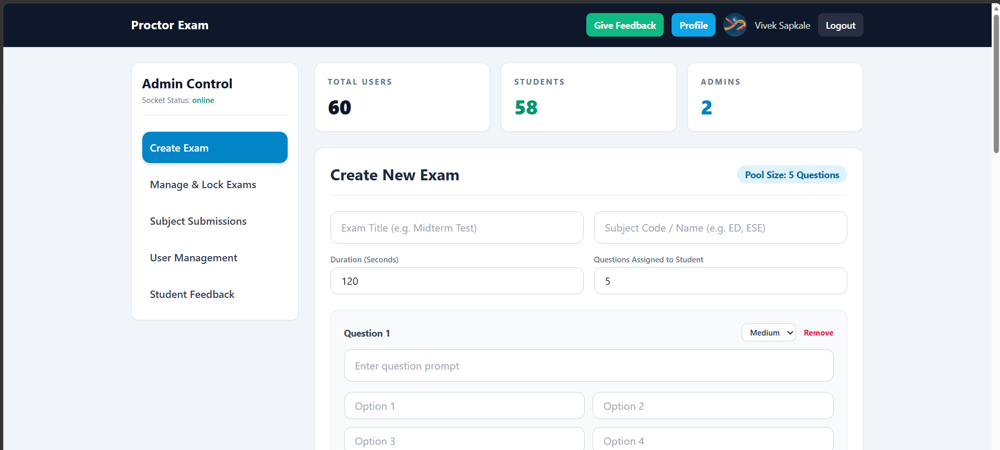
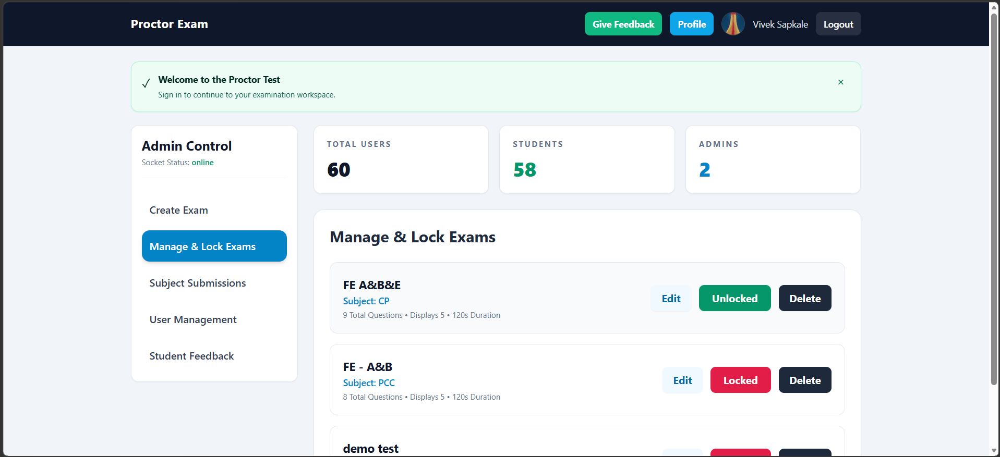
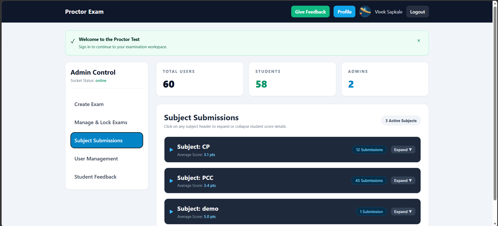
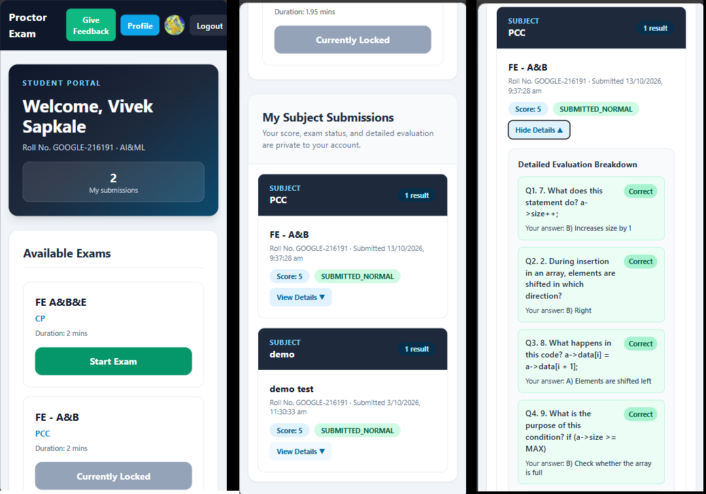
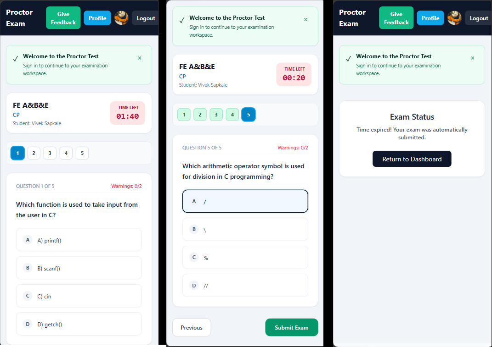

# 🎓 Proctor Exam System

**A self-hosted, mobile-friendly platform for running secure multiple-choice tests in classrooms, with timed exams, randomized questions, tab-switch warnings, and instant evaluation.**

Built for faculty who want to assess students quickly and for students who want to get comfortable with proctored test environments, without sending their data to a third-party service.

> **Project status:** This README describes the current **V2** code. Face detection, cheat detection, a granular permission hierarchy, and spreadsheet export are planned for V3 and are not yet in this repository.


Admin Panel




User/Student Panel




---

## Why this project exists

- **Students need practice with proctored tests.** Many students are unfamiliar with timed, monitored online exams. Regular use builds that habit before it matters.
- **Viva takes a lot of faculty time.** Students also lose time waiting for their turn. For objective, concept-check assessments, a proctored test can replace or complement viva so both sides save time.
- **Tests fit right after each module.** Faculty can run a short test at the end of a module, in the classroom itself, and get scores and per-question evaluation immediately.
- **Your data stays with you.** Deploy it on your own machine, college server, or your own cloud account. There is no third-party exam platform holding student records.

---

## Key highlights

| | |
| --- | --- |
| 🏫 **Classroom-ready** | Mobile-friendly, so students can take a test on their phone or a lab PC. |
| 🔐 **Privacy-first** | Self-hosted. All data lives in your own MongoDB instance. |
| ⚡ **Lightweight & fast** | Question pools are randomized per attempt, and results are served from a MongoDB-backed API. |
| 🧑‍🏫 **Faculty-friendly** | Create an exam, add MCQs, unlock it, and review results in minutes. |
| 🔔 **Live updates** | Admins receive submission updates in real time via Socket.IO. |
| 🛠 **Deploy anywhere** | Run it locally, or deploy the frontend and backend on any hosting platform. |

---

## Features

### Admins / Faculty

- Sign in with an admin account bootstrapped from the backend environment.
- Create, edit, lock/unlock, and delete exams.
- Add a pool of multiple-choice questions and configure the duration and the number of questions shown. Questions are selected randomly for each attempt.
- Review registered user profiles and manage user details and roles.
- View student submissions, scores, statuses, and per-question evaluation details.
- Review student feedback and mark it as read.
- Receive submission updates through Socket.IO.

### Students

- Register with email and password, or sign in with Google.
- Complete the student profile with name, branch/department, and roll number.
- View available exams, take an unlocked exam, and see the score and evaluation afterwards.
- Review prior results and question-level feedback.
- Submit feedback to the admin.

---

## Exam safeguards (V2)

- ⏱ A countdown timer automatically submits the exam when time expires.
- ⚠️ Leaving the exam tab triggers a warning. The first two tab switches warn the student; the third triggers automatic submission with a *disqualified* status.
- 🚫 Copy, paste, and context-menu actions are blocked on the exam page.

> **Limitations, stated plainly:** V2 is a *basic awareness and deterrence* layer, not a full anti-cheating system. It does **not** perform face detection or camera monitoring, and it cannot reliably detect activity on other devices or applications. Browser and OS behavior can affect visibility events. It works best for in-class, supervised tests, where a faculty member is present, and for low-to-medium-stakes assessments such as module tests and viva-style concept checks.

---

## Who is it for?

- **Faculty and teachers** who want quick, low-overhead module tests or a faster alternative to oral viva for objective topics.
- **Students** who want regular practice in a timed, proctored-style environment.
- **Developers** who can deploy and customize it for their institution, and extend it (face detection, analytics, exports) in V3.

---

## Tech stack

- **Frontend:** React 18, Vite, React Router, Axios, Tailwind CSS
- **Backend:** Node.js, Express, Mongoose, MongoDB
- **Authentication:** JWT, bcrypt, Google Identity Services / Google ID token verification
- **Live updates:** Socket.IO

## Project layout

```text
.
├── backend/
│   ├── config/          # MongoDB connection and admin bootstrap
│   ├── controllers/     # Authentication, exam, submission, and feedback logic
│   ├── middleware/      # JWT authentication and admin authorization
│   ├── models/          # Mongoose data models
│   ├── routes/          # REST API routes
│   ├── socket/          # Socket.IO setup and live events
│   ├── tests/           # Backend tests
│   ├── .env.example     # Backend environment template
│   └── server.js        # Express entry point (default port 5000)
└── frontend/
    ├── src/
    │   ├── components/  # Shared UI
    │   ├── context/     # Authentication state
    │   └── pages/       # Login, student, exam, and admin screens
    └── .env.example     # Frontend environment template
```

---

## Quick start

### Requirements

- Node.js 18 or newer and npm
- MongoDB running locally, or a MongoDB Atlas connection string
- A Google OAuth web client ID (only if you want Google sign-in)

### 1. Clone the repository

```bash
git clone https://github.com/Viveksapkale22/Procter_exam_system_v2.git
cd Procter_exam_system_v2
```

### 2. Configure and start the backend

```powershell
cd backend
Copy-Item .env.example .env
```

Open `backend/.env` and set the values described below, then:

```powershell
npm install
npm run dev
```

The API runs at `http://localhost:5000`. Health check: `http://localhost:5000/health`.

### 3. Configure and start the frontend

In a second terminal from the repository root:

```powershell
cd frontend
Copy-Item .env.example .env.local
npm install
npm run dev
```

Open the Vite URL printed in the terminal (normally `http://localhost:5173`).

---

## Environment variables

### Backend: `backend/.env`

| Variable | Required | Purpose |
| --- | --- | --- |
| `MONGO_URI` | Recommended | MongoDB connection URI, e.g. `mongodb://127.0.0.1:27017`. For Atlas, use your cluster's connection string. |
| `DB_NAME` | No | Database name. Defaults to `proctor_exam_system`. |
| `JWT_SECRET` | Yes for a secure deployment | Secret used to sign login tokens. Use a long, randomly generated value. |
| `ADMIN_NAME` | No | Display name for the bootstrapped admin. |
| `ADMIN_EMAIL` | Set with `ADMIN_PASSWORD` | Email for the bootstrapped admin account. |
| `ADMIN_PASSWORD` | Set with `ADMIN_EMAIL` | Admin password; at least 12 characters. |
| `GOOGLE_CLIENT_ID` | Only for Google sign-in | Google OAuth web client ID. Must match the frontend client ID. |
| `FRONTEND_URL` | No | Additional allowed frontend origin(s), comma-separated. |
| `PORT` | No | API port. Defaults to `5000`. |

When both admin variables are set, the backend creates or updates that admin account at startup. Never put admin credentials in the frontend or source code.

If `MONGO_URI` is omitted, the backend attempts to use an in-memory MongoDB server. Data stored that way is temporary and only suitable for development and testing.

### Frontend: `frontend/.env.local`

| Variable | Required | Purpose |
| --- | --- | --- |
| `VITE_API_BASE` | No for local development | API base URL including `/api`. Defaults to `http://localhost:5000/api` in local development. |
| `VITE_GOOGLE_CLIENT_ID` | Only for Google sign-in | Same client ID as `GOOGLE_CLIENT_ID` in the backend. |
| `VITE_SOCKET_URL` | No | Socket.IO server origin. Defaults to the origin derived from `VITE_API_BASE`. |

For Google sign-in, create a Google OAuth **Web application** client in Google Cloud, add the frontend origin (e.g. `http://localhost:5173`) to its authorized JavaScript origins, and set the same client ID in both environment files. Restart both servers after changing environment variables.

> 🔒 Vite variables are embedded in the frontend build. **Never put secrets in `VITE_` variables.** Keep `.env` and `.env.local` private; commit only the example templates.

---

## Deployment

You can run it fully on a local machine or college network, or deploy it online:

- **Backend:** any Node.js host (Render, Railway, a VPS, etc.)
- **Database:** self-hosted MongoDB or MongoDB Atlas
- **Frontend:** any static host (Vercel, Netlify, etc.), with `VITE_API_BASE` pointing to your deployed API

Set `FRONTEND_URL` on the backend to your deployed frontend origin, and use a strong `JWT_SECRET` and admin password in production.

---

## How to use

### Admin / Faculty workflow

1. Start the backend and frontend.
2. Sign in with the admin credentials from `backend/.env`.
3. Create an exam: title, subject, duration, and question count. Then add enough MCQs for that count.
4. Unlock the exam for students. Lock it to prevent new attempts.
5. Review students, submissions, scores, statuses, and detailed evaluations in the dashboard.
6. Read and mark student feedback.

The system currently has `admin` and `student` roles.

### Student workflow

1. Register with email/password or use Google sign-in. New Google users complete their profile first.
2. Pick an available, unlocked exam.
3. Answer before the countdown ends. Avoid switching tabs: the third switch triggers automatic submission.
4. Return to the dashboard to see the score, status, and question-level evaluation.
5. Use **Give Feedback** to message the admin.

---

## Data and export

MongoDB stores user profiles, exams, feedback, and submissions via Mongoose models. The admin dashboard can review results, but V2 does **not** include Excel/CSV export. That is planned for V3.

## Tests and production build

```powershell
cd backend
npm test
```

```powershell
cd frontend
npm run build
```

---

## Roadmap (V3)

- [ ] Face detection and computer-vision-based monitoring
- [ ] Improved suspicious-activity detection and handling
- [ ] Finer-grained admin / permission hierarchy
- [ ] Spreadsheet (Excel/CSV) export of results

These are planned and **not** part of V2.

## Contributing

Feedback, issues, and pull requests are welcome. If you're a faculty member or developer deploying this for your class, I'd love to hear how it goes.

## Author

**Vivek Sapkale**: [GitHub](https://github.com/Viveksapkale22)
